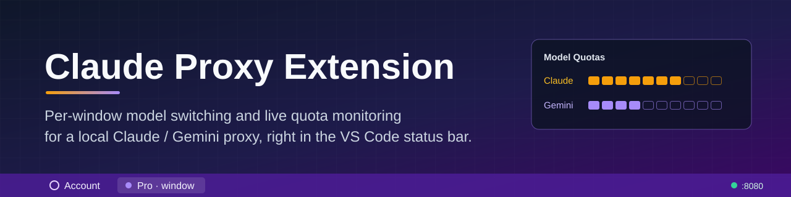
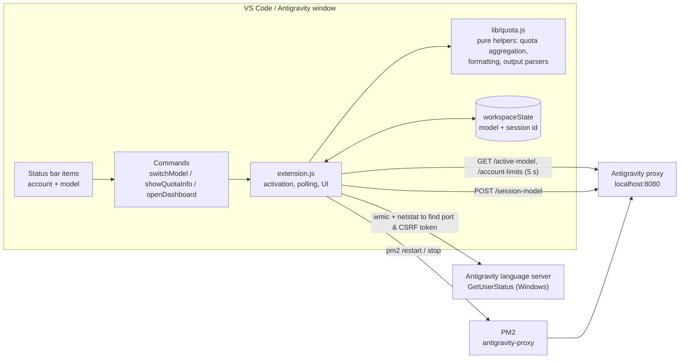

<p align="center">
  
</p>

<p align="center"><b>Per-window model switching and live quota monitoring for a local Claude / Gemini proxy, right in the VS Code status bar.</b></p>

<p align="center">
  <a href="LICENSE"></a>
  
  <a href="https://github.com/muhib-karim/Claude-Proxy-Extension/actions/workflows/ci.yml"></a>
</p>

# Antigravity Proxy Status (VS Code extension)

A JavaScript VS Code / Antigravity extension that sits in the status bar and talks to a locally running
**Antigravity Claude proxy** on `localhost:8080`. You can see which model the current window is using,
switch models in one click, and check per-account Claude and Gemini quota without leaving the editor.

It's published on Open VSX as **[`ai-dev-2024.claude-proxy-status`](https://open-vsx.org/extension/ai-dev-2024/claude-proxy-status)**.


## Key features

- **Two status bar items.** An account item shows connection state and the signed-in account. A model item shows the current model, plus `Offline` (red) or `Disabled` (warning).
- **One-click model switching** between 6 preset models: Flash, Pro, Opus, Sonnet, Grok and Perplexity. The selected model is sent to the proxy's `/session-model` endpoint.
- **Per-workspace model memory.** Each workspace stores its own model and session id in `workspaceState`, so two windows can use different models at the same time. When the proxy restarts, the saved model is sent to it again automatically.
- **Quota popup.** Shows the overall Claude and Gemini remaining quota, using the minimum across accounts. Each family gets a per-model breakdown and a 10-segment bar. Every Google account is listed, sorted by remaining Claude quota, with a time until reset.
- **Health polling.** While the proxy is enabled, `/active-model` and `/account-limits` are polled every 5 seconds, and the signed-in Antigravity account is refreshed every 60 seconds, on window focus and on auth changes. While it is disabled nothing is polled.
- **Proxy on/off toggle** at the top of the model menu. Enabling it restarts the proxy via [PM2](https://pm2.keymetrics.io/) and disabling it stops the proxy. The choice persists across restarts. It defaults to **off**, so the extension makes no requests and starts no processes unless you opt in.
- **Open Dashboard** command, which opens `http://localhost:8080/dashboard`.

| Model switcher | Status bar |
|---|---|
|  |  |

## Quick start

**Requirements**
- VS Code or Antigravity `1.80.0+`
- The Antigravity Claude proxy running on `localhost:8080`. It's a separate project and isn't included here. For the enable/disable toggle, register it with PM2 as `antigravity-proxy` (or set [`antigravity.proxyScriptPath`](#settings) and let the extension register it).

**Install from Open VSX**: search for *Antigravity Proxy Status* in the Extensions view, or install from the
[Open VSX page](https://open-vsx.org/extension/ai-dev-2024/claude-proxy-status).

**Install from source**
```bash
git clone https://github.com/muhib-karim/Claude-Proxy-Extension.git
cd Claude-Proxy-Extension
npm ci
npm run package                     # same as: npx @vscode/vsce package -> claude-proxy-status-<version>.vsix
code --install-extension claude-proxy-status-*.vsix
```
You can also open the folder in VS Code and press <kbd>F5</kbd> to launch an Extension Development Host.

## Usage

| Command palette | What it does |
|---|---|
| `Antigravity: Switch Model` | Pick a model for this window, or enable/disable the proxy |
| `Antigravity: Show Quota Info` | Open the quota popup (same as clicking the account item) |
| `Antigravity: Open Dashboard` | Open `http://localhost:8080/dashboard#overview` in the browser |

| Status bar | Click action |
|---|---|
| Account item (`$(account) user`) | Quota popup |
| Model item (`💎 Pro`, `$(warning) Offline`, `$(debug-stop) Disabled`) | Model switcher |

## Settings

| Setting | Default | What it does |
|---|---|---|
| `antigravity.proxyScriptPath` | empty | Absolute path of the proxy's entry script, for example `/home/me/proxy/src/index.js`. Only used as a fallback: when `pm2 restart antigravity-proxy` fails because the proxy isn't registered with PM2 yet, the extension runs `pm2 start <path> --name antigravity-proxy`. Leave it empty to only ever use `pm2 restart`. |

The setting is machine-scoped, so a workspace can't set it. Relative paths and values containing quotes, backticks, a dollar or percent sign, line breaks or a trailing backslash are rejected before anything is executed.

## Architecture



- `extension.js` contains everything that touches the `vscode` API, HTTP or child processes.
- `lib/quota.js` has no `vscode` dependency. It aggregates quotas (minimum per model and per family across healthy accounts), sorts accounts, draws the quota bars, formats reset times, maps model ids to display names, and parses `wmic`/`netstat` output and the language server's reply. That keeps it unit-testable with plain Node.
- `lib/pm2.js` builds the PM2 commands and validates `antigravity.proxyScriptPath`, also without `vscode`.

## Testing

```bash
npm ci          # install dev dependencies (ESLint)
npm run lint    # ESLint 9 (flat config, eslint.config.js)
npm test        # node --test on the files listed in package.json
```

The tests use Node's built-in `node:test` and need no VS Code, proxy, PM2 or Windows:
- `test/quota.test.js` and `test/pm2.test.js` cover the pure helpers: quota aggregation, account sorting, bar clamping, reset-time formatting, model naming, `wmic`/`netstat` parsing, and the PM2 command builder.
- `test/extension.test.js` and `test/extension.behavior.test.js` load `extension.js` against the harness in `test/support/harness.js`, which replaces `vscode`, `http`, `https` and `child_process` with scriptable fakes. They cover activation, polling, the model switcher, PM2 start/stop, account detection and the error paths.
- `test/package-files.test.js` guards the packaging and CI rules described below.

GitHub Actions ([`ci.yml`](.github/workflows/ci.yml)) runs three jobs on every push to `master` and every pull request:
- **Lint and test** on Node 20 and 22.
- **Package dry run and content check**: plants decoy secret files, builds the VSIX without publishing it, lists what is inside and fails if anything other than the runtime files shipped. The checked VSIX is kept as a build artifact.
- **Secret scan**: [gitleaks](https://github.com/gitleaks/gitleaks) over the full git history and the checked-out files.

## Packaging and releasing

```bash
npm run verify:package   # lists what would be packaged and fails on anything that must not ship
npm run package          # builds claude-proxy-status-<version>.vsix
```

- `.vscodeignore` is an allowlist: everything is excluded, then only `extension.js`, `lib/*.js`, `package.json`, README, CHANGELOG, LICENSE and the icon are re-included. A local `.env`, `.secrets`, key file, old `.vsix` or scratch folder is never packaged.
- `scripts/check-vsix-files.js` enforces that. It fails on `.secrets`, `.env*`, `*.pem`, `*.key`, `*.vsix`, `node_modules/`, `test/`, `extracted-*`, on any file outside the allowlist and on a missing runtime file. CI runs it against `vsce ls` and against the built VSIX; `publish.ps1` runs it before packaging.
- `publish.ps1` (Windows) publishes to Open VSX and reads `OVSX_TOKEN` from the environment or a local `.env`. Never commit tokens: `.gitignore` covers `.env*` and `.secrets`.
- README images are loaded from this GitHub repository once packaged, so the repository has to be public for them to show on Open VSX.

## Project structure

```
extension.js                  # VS Code entry point (activate/deactivate, status bar, commands, polling)
lib/quota.js                  # pure, unit-tested helpers (quotas, formatting, parsers)
lib/pm2.js                    # pure, unit-tested PM2 command builder
test/                         # node:test suites; test/support/harness.js fakes vscode, http and exec
scripts/check-vsix-files.js   # package content check (npm run verify:package)
docs/banner.png               # README banner (banner.svg is its source; vsce rejects SVG images)
.vscodeignore                 # allowlist of files that go into the VSIX
.gitleaksignore               # one documented historical gitleaks finding
eslint.config.js              # lint configuration
publish.ps1                   # check + package + publish to Open VSX (reads OVSX_TOKEN from env/.env)
CHANGELOG.md
icon.png, screenshot*.png
```

## Limitations and roadmap

- Detecting the signed-in Antigravity account uses `wmic`, `netstat` and `findstr`, so it **only works on Windows**. On other platforms the account name just isn't shown. `wmic` is deprecated on recent Windows builds, so moving to PowerShell/CIM is a natural next step.
- The proxy address is fixed at `localhost:8080`. Making it a user setting is on the roadmap.
- The enabled/disabled choice is read when a window starts. Toggling it in one window doesn't update other open windows until they reload.
- The tests run against a fake `vscode` API, not a real VS Code instance (no `@vscode/test-electron` run), so rendering and real editor behaviour are not covered by automated tests.

## Contributing

Issues and pull requests are welcome. Before opening a pull request, run `npm test` and `npm run lint`. Please keep each pull request focused and say how you tested it.

## License

MIT License. Copyright 2026 Muhib Karim. See [LICENSE](LICENSE).

