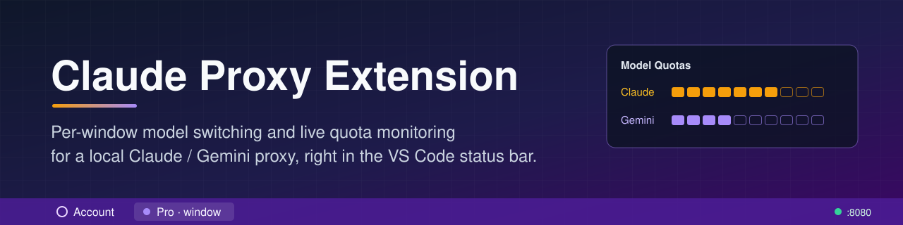
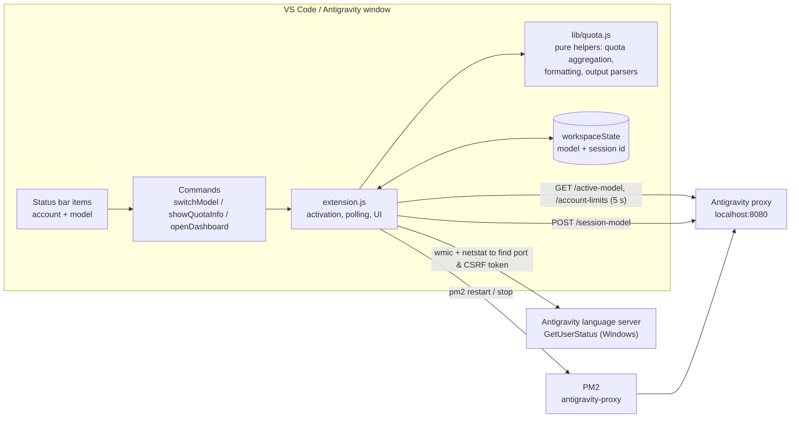

<p align="center">
  
</p>

<p align="center"><b>Per-window model switching and live quota monitoring for a local Claude / Gemini proxy, right in the VS Code status bar.</b></p>

<p align="center">
  <a href="LICENSE"></a>
  
  <a href="https://github.com/muhib-karim/Claude-Proxy-Extension/actions/workflows/ci.yml"></a>
</p>

# Antigravity Proxy Status (VS Code extension)

A JavaScript VS Code / Antigravity extension that sits in the status bar and talks to a locally running
**Antigravity Claude proxy** on `localhost:8080`. You can see which model the current window is using,
switch models in one click, and check per-account Claude and Gemini quota without leaving the editor.

It's published on Open VSX as **[`ai-dev-2024.claude-proxy-status`](https://open-vsx.org/extension/ai-dev-2024/claude-proxy-status)**.


## Key features

- **Two status bar items.** An account item shows connection state and the signed-in account. A model item shows the current model, plus `Offline` (red) or `Disabled` (warning).
- **One-click model switching** between 6 preset models: Flash, Pro, Opus, Sonnet, Grok and Perplexity. The selected model is sent to the proxy's `/session-model` endpoint.
- **Per-workspace model memory.** Each workspace stores its own model and session id in `workspaceState`, so two windows can use different models at the same time. A proxy restart doesn't change them.
- **Quota popup.** Shows the overall Claude and Gemini remaining quota, using the minimum across accounts. Each family gets a per-model breakdown and a 10-segment bar. Every Google account is listed, sorted by remaining Claude quota, with a time until reset.
- **Health polling.** `/active-model` and `/account-limits` are polled every 5 seconds. The signed-in Antigravity account is refreshed every 60 seconds, on window focus and on auth changes.
- **Proxy on/off toggle** at the top of the model menu. Enabling it restarts the proxy via [PM2](https://pm2.keymetrics.io/) and disabling it stops the proxy. The choice persists across restarts. It defaults to **off**, so the extension never starts processes unless you opt in.
- **Open Dashboard** command, which opens `http://localhost:8080/dashboard`.

| Model switcher | Status bar |
|---|---|
|  |  |

## Quick start

**Requirements**
- VS Code or Antigravity `1.80.0+`
- The Antigravity Claude proxy running on `localhost:8080`. It's a separate project and isn't included here. For the enable/disable toggle, register it with PM2 as `antigravity-proxy`.

**Install from Open VSX**: search for *Antigravity Proxy Status* in the Extensions view, or install from the
[Open VSX page](https://open-vsx.org/extension/ai-dev-2024/claude-proxy-status).

**Install from source**
```bash
git clone https://github.com/muhib-karim/Claude-Proxy-Extension.git
cd Claude-Proxy-Extension
npm ci
npx @vscode/vsce package            # produces claude-proxy-status-<version>.vsix
code --install-extension claude-proxy-status-*.vsix
```
You can also open the folder in VS Code and press <kbd>F5</kbd> to launch an Extension Development Host.

## Usage

| Command palette | What it does |
|---|---|
| `Antigravity: Switch Model` | Pick a model for this window, or enable/disable the proxy |
| `Antigravity: Show Quota Info` | Open the quota popup (same as clicking the account item) |
| `Antigravity: Open Dashboard` | Open `http://localhost:8080/dashboard#overview` in the browser |

| Status bar | Click action |
|---|---|
| Account item (`$(account) user`) | Quota popup |
| Model item (`💎 Pro`, `$(warning) Offline`, `$(debug-stop) Disabled`) | Model switcher |

## Architecture



- `extension.js` contains everything that touches the `vscode` API, HTTP or child processes.
- `lib/quota.js` has no `vscode` dependency. It aggregates quotas (minimum per model and per family across healthy accounts), sorts accounts, draws the quota bars, formats reset times, maps model ids to display names, and parses `wmic`/`netstat` output. That keeps it unit-testable with plain Node.

## Testing

```bash
npm ci          # install dev dependencies (ESLint)
npm run lint    # ESLint 9 (flat config, eslint.config.js)
npm test        # node --test test/*.test.js
```

There are 13 tests using Node's built-in `node:test`:
- `test/quota.test.js` covers the pure helpers: quota aggregation, account sorting, bar clamping, reset-time formatting, model naming, and `wmic`/`netstat` parsing.
- `test/extension.test.js` is an activation smoke test. It loads `extension.js` against a minimal fake `vscode` module and checks that every command declared in `package.json` gets registered and that the session id is stored per workspace.

GitHub Actions ([`ci.yml`](.github/workflows/ci.yml)) runs lint and tests on Node 20 and 22.

## Project structure

```
extension.js            # VS Code entry point (activate/deactivate, status bar, commands, polling)
lib/quota.js            # pure, unit-tested helpers
test/                   # node:test suites
docs/banner.svg         # README banner (banner.png: PNG render used when packaging, since vsce rejects SVG)
eslint.config.js        # lint configuration
publish.ps1             # package + publish to Open VSX (reads OVSX_TOKEN from env/.env)
CHANGELOG.md
icon.png, screenshot*.png
```

## Limitations and roadmap

- Detecting the signed-in Antigravity account uses `wmic`, `netstat` and `findstr`, so it **only works on Windows**. On other platforms the account name just isn't shown. `wmic` is deprecated on recent Windows builds, so moving to PowerShell/CIM is a natural next step.
- The proxy address is fixed at `localhost:8080`. Making it a user setting is on the roadmap.
- The PM2 fallback in the offline model switcher assumes a specific proxy checkout path under the home directory.
- The tests don't drive a real VS Code instance (no `@vscode/test-electron` run). UI behaviour beyond activation is not covered by automated tests.

## License

[MIT](LICENSE)
